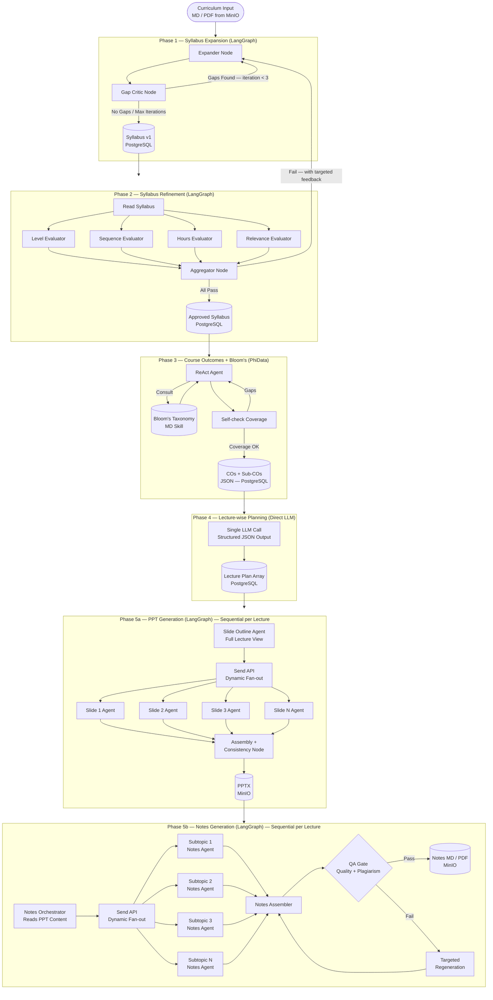
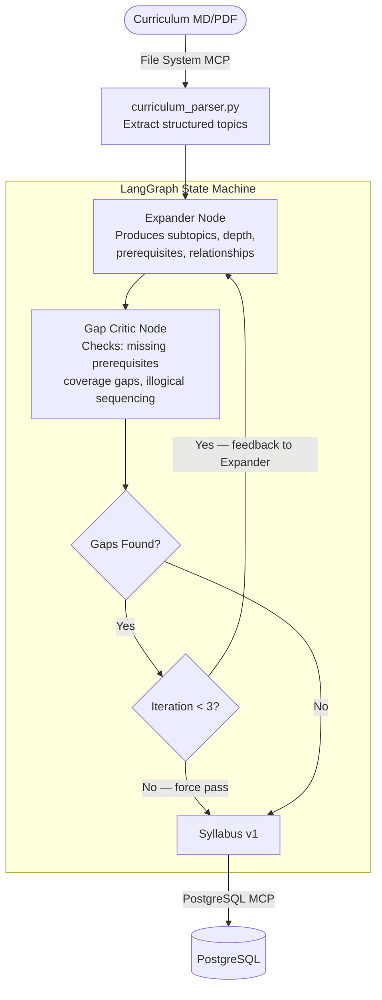
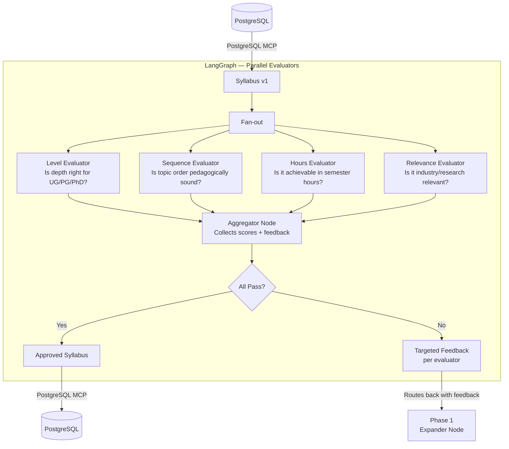
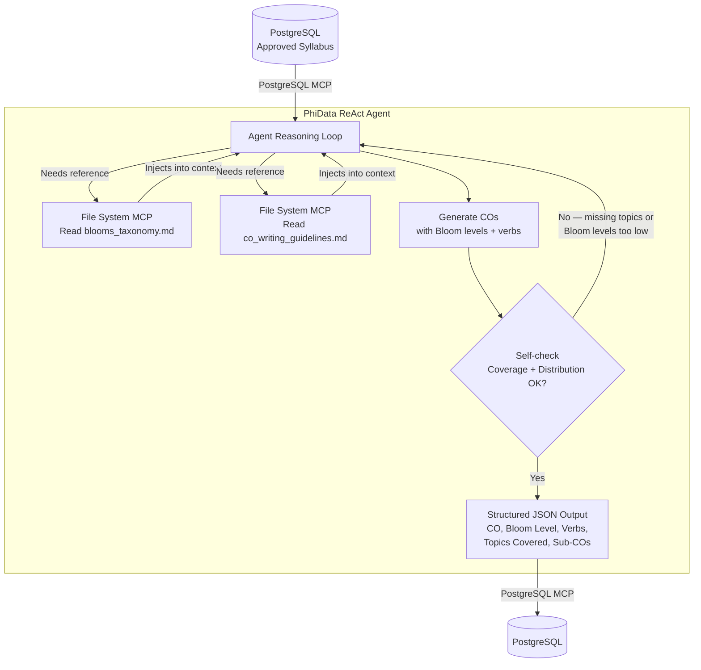
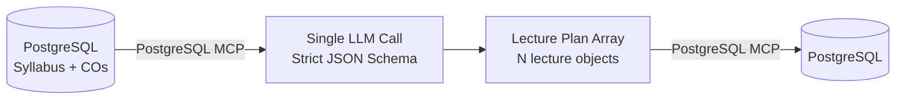
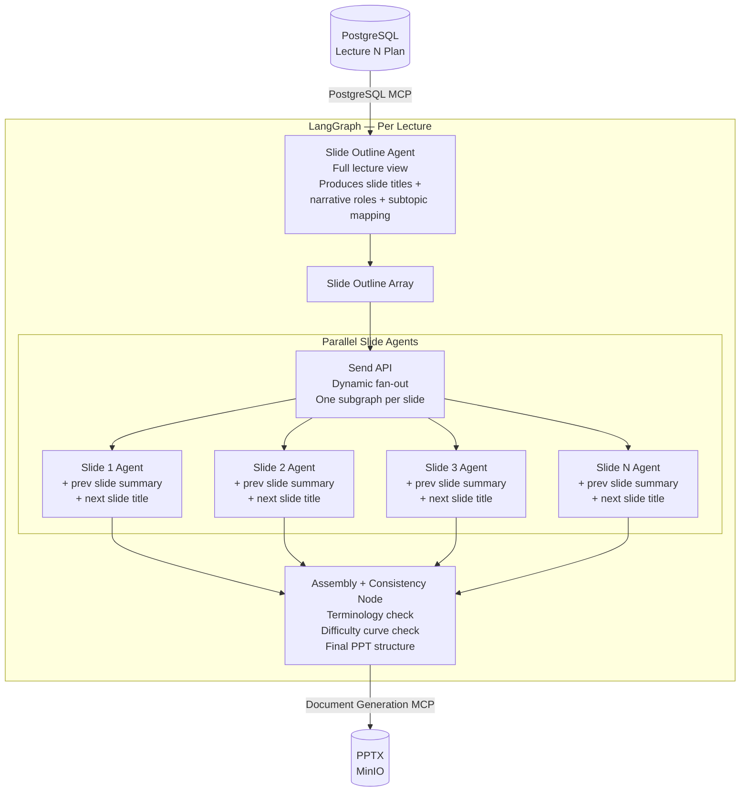
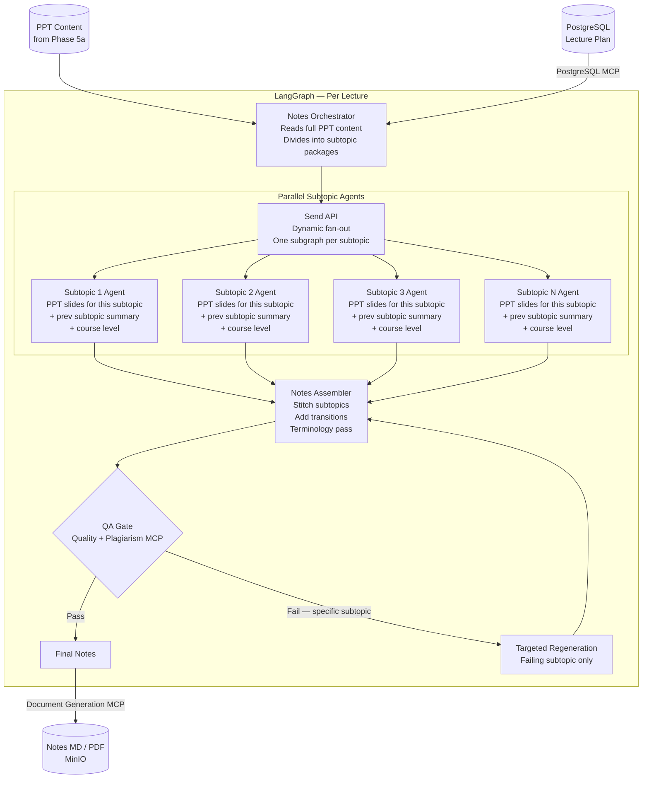
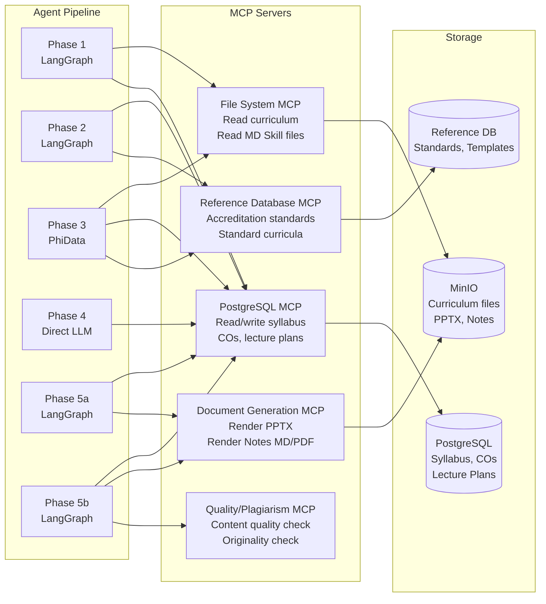
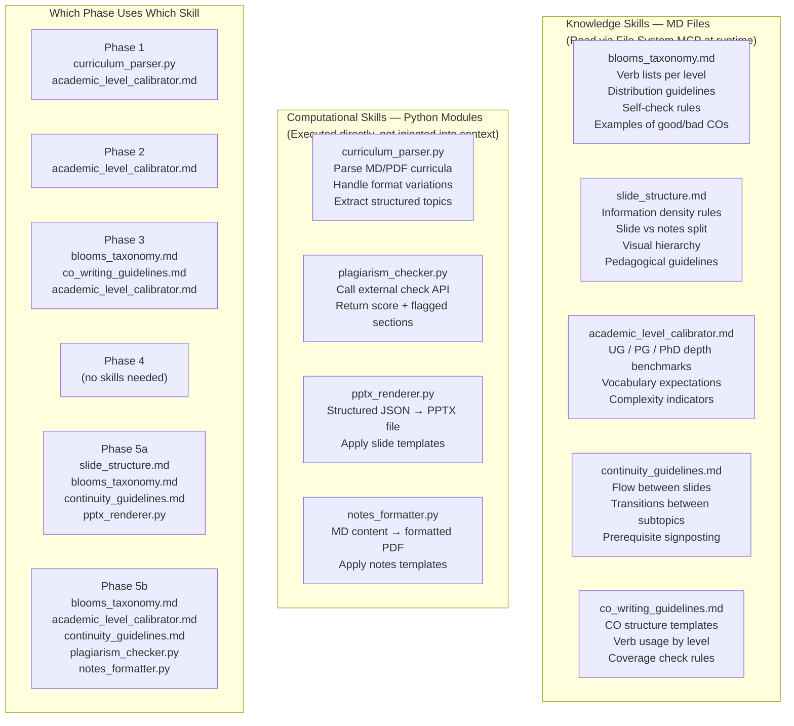

# Educational Content Generation — Agentic Architecture

## System Purpose

An agentic pipeline that takes a raw course curriculum and produces:
- A refined, pedagogically sound syllabus
- Course Outcomes (COs) and Sub-COs mapped to Bloom's Taxonomy
- A lecture-wise content plan
- Generated PPTs per lecture
- Generated lecture notes per lecture (informed by PPT content)

Designed to process **200+ courses** running on **2 × DGX nodes (8 × H100 each)**.

---

## Overall Pipeline Flow



---

## Phase 1 — Syllabus Expansion

**Framework:** LangGraph
**Pattern:** Generator → Critic Cyclic Graph with Conditional Edge

### What Happens

The Expander takes the raw curriculum and produces a detailed structured syllabus with subtopics, depth indicators, and topic relationships. The Gap Critic evaluates it specifically for missing prerequisites, coverage gaps, and illogical sequencing — not for style or completeness in general. If gaps are found, it sends targeted feedback back to the Expander. Maximum 3 iterations, then force-pass.

### Skills Used
- `curriculum_parser.py` — parses raw MD/PDF curriculum into structured input
- `academic_level_calibrator.md` — ensures expansion depth matches course level (UG/PG/PhD)

### MCP Used
- **File System MCP** — reads curriculum from MinIO
- **PostgreSQL MCP** — writes approved syllabus



---

## Phase 2 — Syllabus Refinement

**Framework:** LangGraph
**Pattern:** Parallel Evaluator Nodes + Conditional Routing

### What Happens

Four evaluator nodes run fully in parallel, each evaluating the syllabus on a single independent axis. They each produce a score and specific actionable feedback. The Aggregator collects all four outputs. If all pass, syllabus is approved. If any fail, the aggregated feedback routes back to Phase 1 Expander with precise instructions on what to fix.

### Skills Used
- `academic_level_calibrator.md` — used by Level Evaluator

### MCP Used
- **PostgreSQL MCP** — reads syllabus, writes approved syllabus
- **Reference Database MCP** — Level and Relevance evaluators check against accreditation standards



---

## Phase 3 — Course Outcomes + Bloom's Taxonomy

**Framework:** PhiData (Agno)
**Pattern:** Single ReAct Agent with MD Skill as Tool

### What Happens

A single capable agent with the Bloom's Taxonomy MD skill as a consultable tool. The agent reasons about the full syllabus, consults the taxonomy reference when needed, generates 5-8 Course Outcomes, maps each to the correct Bloom's level with appropriate verbs, writes Sub-COs, then self-checks that all syllabus topics are covered and that Bloom's levels are appropriately distributed. Output is strictly structured JSON.

### Why PhiData Here, Not LangGraph

This is the only phase where the task is **genuinely self-contained single-agent reasoning**. LangGraph would add graph overhead for what is a single agent with a single tool. PhiData's Agent class is purpose-built for this pattern — clean tool use, structured output enforcement, and internal reasoning loop in one definition.

### Skills Used
- `blooms_taxonomy.md` — primary tool the agent consults (via File System MCP at runtime)
- `co_writing_guidelines.md` — verb usage, CO structure, what makes a well-formed CO
- `academic_level_calibrator.md` — ensures COs match course level

### MCP Used
- **File System MCP** — agent reads MD skill files at runtime
- **PostgreSQL MCP** — reads approved syllabus, writes COs + Sub-COs



---

## Phase 4 — Lecture-wise Planning

**Framework:** None (Direct LLM Call)
**Pattern:** Single structured LLM call with JSON output schema

### What Happens

Takes the approved syllabus and COs as input. One LLM call with a strict output schema. Allocates topics into lectures, determines pacing, maps each lecture to the COs it addresses. Nothing is uncertain here — this is allocation logic, not reasoning. Output is the lecture plan array that drives Phases 5a and 5b.

### Output Schema (per lecture)
```json
{
  "lecture_number": 1,
  "title": "Introduction to ...",
  "duration_minutes": 60,
  "subtopics": ["subtopic_1", "subtopic_2"],
  "cos_addressed": ["CO1", "CO3"],
  "bloom_levels_targeted": ["Remember", "Understand"],
  "prerequisite_lectures": []
}
```

### MCP Used
- **PostgreSQL MCP** — reads syllabus + COs, writes lecture plan array



---

## Phase 5a — PPT Generation

**Framework:** LangGraph with Send API
**Pattern:** Outline Agent → Dynamic Slide-level Parallel Subagents → Assembly
**Execution:** Sequential per lecture (Lecture 1 complete before Lecture 2 starts)

### What Happens

**Node 1 — Slide Outline Agent:** Reads the full lecture plan. Produces a slide-by-slide outline — title, which subtopic it belongs to, its narrative role (intro / concept / example / summary), and a brief one-line description. This node sees the entire lecture to preserve narrative arc and difficulty progression.

**Node 2 — Send API Fan-out:** Dynamically spawns one subagent per slide based on the outline output. Number of slides is not known until the outline is produced — Send API handles this at runtime.

**Each Slide Agent receives:**
- Its own outline entry
- Summary of the previous slide (for continuity)
- Title of the next slide (for setup)
- Course level (for depth calibration)

**Node 3 — Assembly + Consistency:** Collects all slide outputs. Runs a consistency pass on terminology, difficulty curve, and visual language. Produces final PPT structure passed to Document Generation MCP.

### Why Slide-level, Not Subtopic-level Parallelism

A PPT is a **narrative arc**. Subtopic-level subagents produce coherent islands that stitch together awkwardly. Slide-level parallelism distributes content generation while the outline node preserves the global structure. Context size is not a real constraint at the lecture level — the real constraint is content quality, which is solved by the outline-first approach.

### Skills Used
- `slide_structure.md` — information density, what belongs on slide vs notes, visual hierarchy
- `blooms_taxonomy.md` — slide objectives must map to lecture COs
- `continuity_guidelines.md` — used by assembly node

### MCP Used
- **PostgreSQL MCP** — reads lecture plan
- **Document Generation MCP** — renders final PPTX and saves to MinIO



---

## Phase 5b — Notes Generation

**Framework:** LangGraph with Send API
**Pattern:** Orchestrator → Dynamic Subtopic-level Parallel Subagents → Assembly → QA
**Execution:** After PPT for same lecture is complete. Sequential per lecture.

### What Happens

**Node 1 — Notes Orchestrator:** Reads the full PPT content for the lecture. Divides into subtopic packages — each package contains the slides belonging to that subtopic plus surrounding context.

**Node 2 — Send API Fan-out:** Spawns one notes agent per subtopic. Each agent gets its PPT slides, a summary of what the previous subtopic covered, and the course level. Generates long-form notes: explanation, derivations, worked examples, references, connections to COs.

**Node 3 — Notes Assembler:** Stitches subtopic notes into one document. Adds transitions between subtopics. Enforces consistent terminology across the document.

**Node 4 — QA Gate:** Calls Quality/Plagiarism MCP. If content fails, triggers targeted regeneration of the specific failing subtopic — not a full redo.

### Why Subtopic-level (Not Slide-level) Here

Notes output per subtopic is genuinely large — 2,000–4,000 tokens each. Unlike slides, subtopic notes ARE relatively self-contained because the PPT already provides the structure the agent expands on. Parallel generation here gives real quality AND throughput gains.

### Skills Used
- `blooms_taxonomy.md` — notes depth should reflect CO Bloom levels
- `academic_level_calibrator.md` — explanation depth per UG/PG/PhD
- `continuity_guidelines.md` — transitions between subtopics

### MCP Used
- **PostgreSQL MCP** — reads lecture plan + PPT content reference
- **Quality/Plagiarism MCP** — QA gate check
- **Document Generation MCP** — renders final notes MD/PDF, saves to MinIO



---

## MCP Layer

MCP (Model Context Protocol) provides a **standardized interface** between agents and external systems. Agents call MCP servers using a consistent protocol — swapping the underlying system (e.g. changing storage from MinIO to S3) requires no changes to agent code.



### MCP Server Responsibilities

| MCP Server | Phases | What It Does |
|---|---|---|
| **File System MCP** | 1, 3 | Reads curriculum files from MinIO. Reads MD Skill files at agent runtime |
| **PostgreSQL MCP** | 1, 2, 3, 4, 5a, 5b | Central state store. Each phase reads previous phase output and writes its own |
| **Document Generation MCP** | 5a, 5b | Agents pass structured content — MCP handles rendering PPTX and MD/PDF files |
| **Reference Database MCP** | 2, 3 | Evaluators check against accreditation standards. Phase 3 checks standard CO patterns |
| **Quality/Plagiarism MCP** | 5b | QA gate at notes generation. Returns score + specific failing sections |

---

## Skills Layer

Skills are **reusable capabilities** injected into agent context at runtime. Two types: knowledge skills (MD files read via File System MCP) and computational skills (Python modules executed directly).



### Why MD Files for Knowledge Skills

MD skills work exactly like Claude's own skill system — the agent reads the file via File System MCP, the content is injected into its context before reasoning begins, and the agent applies that knowledge during generation. Benefits:

- Domain experts (faculty) can author and refine skills directly — no engineering needed
- Skill updates take effect immediately without redeployment
- Human-readable and version-controllable in Git
- Multiple agents across multiple phases share the same skill definition

---

## Full Framework Decision Summary

| Phase | Framework | Pattern | Key Reason |
|---|---|---|---|
| **Phase 1** Syllabus Expansion | LangGraph | Generator-Critic Cycle | Conditional cyclic routing is LangGraph's core strength |
| **Phase 2** Syllabus Refinement | LangGraph | Parallel Evaluators + Conditional Routing | Independent evaluation axes with fan-out/fan-in and cross-phase routing on failure |
| **Phase 3** Bloom's Taxonomy + COs | PhiData (Agno) | Single ReAct Agent + MD Tool | Self-contained single agent with tool — PhiData's exact design target. No graph overhead needed |
| **Phase 4** Lecture Planning | None | Direct LLM Call | Zero uncertainty, zero loops — a framework would just be overhead on a function call |
| **Phase 5a** PPT Generation | LangGraph | Outline → Send API → Assembly | Dynamic N-slide parallelism unknown until runtime — Send API handles this natively |
| **Phase 5b** Notes Generation | LangGraph | Orchestrator → Send API → Assembly → QA | Dynamic M-subtopic parallelism + QA gate with targeted regeneration |

---

## Curriculum Storage Decision

| Asset | Storage | Format | Reason |
|---|---|---|---|
| Curriculum | MinIO | **MD (preferred)** or PDF | Read once, fully, at Phase 1. No retrieval needed. MD gives clean structure |
| Syllabus | PostgreSQL | JSONB | Queried and updated across Phases 1 and 2 |
| Course Outcomes | PostgreSQL | JSONB | Referenced by Phases 4, 5a, 5b |
| Lecture Plan | PostgreSQL | JSONB | Drives Phases 5a and 5b |
| PPT Files | MinIO | PPTX | File artifact, served to user |
| Notes Files | MinIO | MD / PDF | File artifact, served to user |
| Cross-curriculum index | Qdrant | Embeddings | **Only if** cross-curriculum search is built — not needed for the core pipeline |

> **Note on Embeddings:** The curriculum is read **once, fully** at Phase 1. Chunking it into embeddings would hurt comprehension by breaking document-level structure. Add embeddings only if you build cross-curriculum search or discovery features as a separate use case.

---

## Skills Directory Structure

```
/skills
  /knowledge                        ← MD files — authored by domain experts
    blooms_taxonomy.md
    slide_structure.md
    academic_level_calibrator.md
    continuity_guidelines.md
    co_writing_guidelines.md

  /computational                    ← Python modules — authored by engineers
    curriculum_parser.py
    plagiarism_checker.py
    pptx_renderer.py
    notes_formatter.py
```
